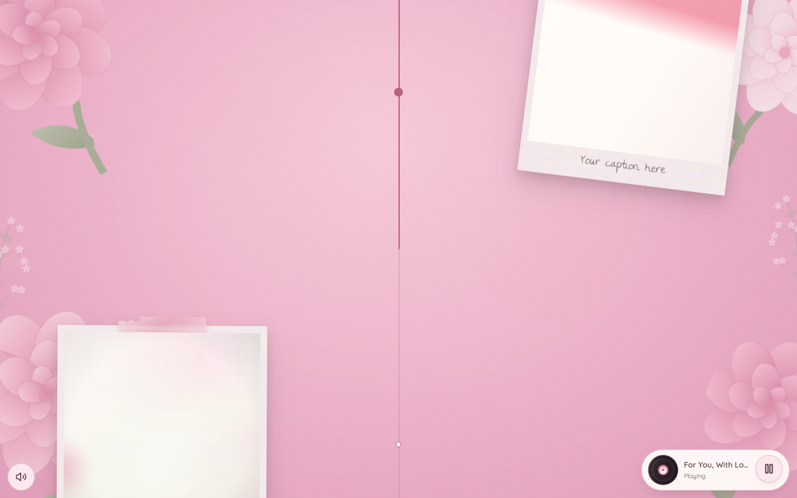

# birthday-greet



A scroll-driven interactive birthday site in five scenes — envelope, card, record, photo wall,
letter. A static bundle: no backend, no runtime network calls. React 19 · Vite · TypeScript ·
Three.js · Motion.

It ships with authored placeholders. Replace the text in `src/content.ts` and drop in your own
photos and music — nothing personal is included.

## Quickstart

Requires Node 24+. `npm run verify` drives your **system Chrome** (no browser download step).

```bash
npm install
npm run dev       # http://localhost:5173
npm run verify    # typecheck + build + the full browser gate
```

## Personalize

| What | Where |
| --- | --- |
| Name, track title, letter, photo captions | `src/content.ts` — every field marked `PLACEHOLDER` |
| Photos | `public/photos/photo-1…6` — a `.mp4` in any slot renders as a looping clip |
| Music | `public/audio/song.mp3`, `public/audio/background.mp3` |
| Page title | `<title>` in `index.html` |

`npm run assets` and `npm run song` regenerate the placeholder media. `index.html` ships with
`noindex, nofollow` — remove that line if you want your page searchable.

Full documentation: [docs/README-full.md](docs/README-full.md).

## Credits

- Text effects — [Magic UI](https://magicui.design) (MIT), vendored
- Surface textures — [ambientCG](https://ambientcg.com) (CC0)
- Fonts — Great Vibes, Quicksand, The Girl Next Door (SIL OFL), self-hosted

## License

MIT — see [LICENSE](LICENSE).
